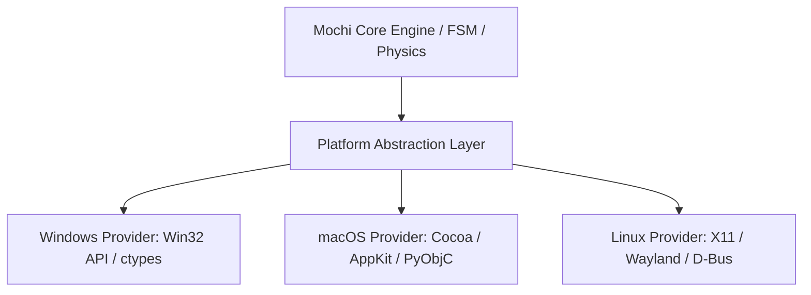
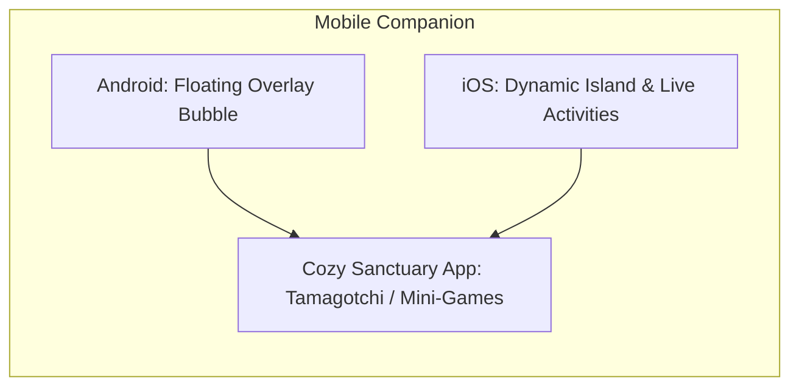
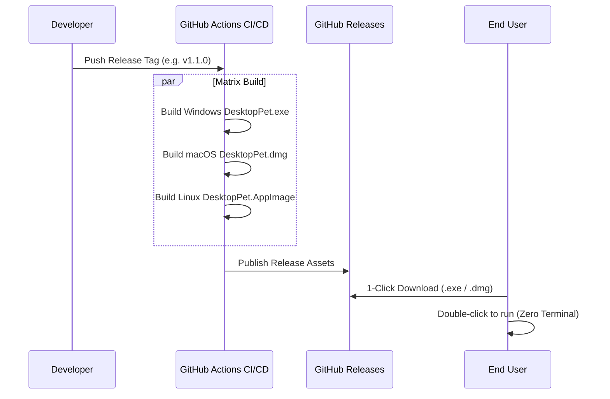

# 🗺️ Mochi Desktop Pet: Cross-Platform & Mobile Expansion Roadmap

This document outlines the architectural roadmap for bringing **Mochi Desktop Pet** to **macOS**, **Linux**, **Mobile (iOS & Android)**, automating zero-setup binary downloads on GitHub, and introducing a zero-code GUI personalization suite.

---

## 📑 Table of Contents
1. [Desktop Cross-Platform Architecture (macOS & Linux)](#1-desktop-cross-platform-architecture-macos--linux)
2. [Mobile Companion Paradigm (Wispr Flow Model)](#2-mobile-companion-paradigm-wispr-flow-model)
3. [Zero-Setup Direct Downloads (GitHub Actions CI/CD)](#3-zero-setup-direct-downloads-github-actions-cicd)
4. [Zero-Code Personalization & Wardrobe Suite](#4-zero-code-personalization--wardrobe-suite)
5. [Implementation Milestones & Execution Plan](#5-implementation-milestones--execution-plan)

---

## 1. Desktop Cross-Platform Architecture (macOS & Linux)

Currently, Mochi leverages Win32 APIs for per-monitor DPI, transparent color-keying, global hotkeys, taskbar height detection, and single-instance mutex IPC. To support macOS and Linux seamlessly without breaking the Windows experience, we introduce a **Platform Abstraction Layer (PAL)**.



### Component Breakdown & Required Adaptations

| Subsystem | Windows (Current) | macOS (Darwin) | Linux (X11 / Wayland) |
| :--- | :--- | :--- | :--- |
| **Window Transparency** | `wm_attributes("-transparentcolor", col)` | Cocoa `NSWindow` transparency via PyObjC or Qt backing (`WA_TranslucentBackground`) | Composite RGBA visual in X11; Layer-Shell protocol on Wayland |
| **Dock / Taskbar Detection** | `SHAppBarMessage(ABM_GETTASKBARPOS)` | `NSScreen.visibleFrame` vs `NSScreen.frame` (detects Dock position & Menu Bar) | `_NET_WORKAREA` root window property via X11 / EWMH |
| **Global Hotkeys** | `RegisterHotKey` Win32 API | `CGEventTap` (with Accessibility Permissions) or `NSEvent` global monitor | X11 `XGrabKey` or FreeDesktop GlobalShortcuts XDG Portal |
| **Single-Instance IPC** | Named Mutex + Named Win32 Event | POSIX Named Domain Socket (`/tmp/mochi_<uid>.sock`) | POSIX Named Domain Socket (`/tmp/mochi_<uid>.sock`) |
| **System Tray** | `pystray._win32` | `pystray._darwin` (macOS status bar item) | `pystray._appindicator` (Ubuntu/GNOME/KDE) |
| **Standalone Package** | One-file `DesktopPet.exe` | Signed `.dmg` / `.app` bundle | Standalone `.AppImage` (runs on Ubuntu, Fedora, Arch) |

> [!NOTE]
> **macOS Tkinter Limitation**: Standard Tkinter on macOS Cocoa does **not** support `-transparentcolor` (color-key transparency). To achieve 100% frameless shaped window transparency on macOS, migrating the UI renderer to **PySide6 / PyQt6** or using a lightweight **PyObjC NSWindow bridge** is recommended for Phase 2.

---

## 2. Mobile Companion Paradigm (Wispr Flow Model)

Wispr Flow achieved breakthrough mobile adoption by breaking out of the standard app box and living as an omnipresent companion across all apps. Mochi can adopt this exact dual-platform paradigm:



### A. Android: Floating Pet Bubble (`SYSTEM_ALERT_WINDOW`)
* **Floating Screen Overlay**: Using Android's `TYPE_APPLICATION_OVERLAY` permission (the same mechanism used by Facebook Messenger Chat Heads and Wispr Flow), Mochi floats directly on top of all Android apps (WhatsApp, Instagram, Chrome, Reddit).
* **Gestures**:
  * **Drag & Toss**: Flick Mochi across the phone screen with gravity and edge bouncing.
  * **Edge Docking**: When inactive, Mochi folds into a discreet half-circle tab on the side of your screen.
  * **Speech Bubbles & Alarms**: Floating cheer-ups, hydration alerts, screen-time warnings, and Pomodoro notifications directly over other apps.

### B. iOS: Dynamic Island & Live Activities (`ActivityKit`)
* Because iOS strictly forbids overlaying windows over third-party apps, Mochi lives in Apple's **Dynamic Island** (iPhone 14 Pro, 15, 16 series) and the **Lock Screen**!
* **Dynamic Island Modes**:
  * **Compact Island**: Mochi's sleeping or happy face sits cutely inside the black pill island while you browse other apps.
  * **Expanded Island (Long-press)**: Expands to reveal Mochi hopping, remaining Pomodoro sprint minutes, cheer-up quotes, and one-tap petting.
* **Interactive Lock Screen Widget**: Pet Mochi directly from your Lock Screen without unlocking your phone.

### C. The Cozy Sanctuary (Full App & Mini-Game)
Tapping Mochi opens the full mobile sanctuary:
1. **Tamagotchi Care**: Feed Mochi snacks (mochi balls, carrots, bubble tea), clean up, and tuck into bed.
2. **Wardrobe & Customization**: Unlock cute hats, ribbon bows, reading glasses, and seasonal skins.
3. **Focus Room & Pomodoro**: Ambient lofi music, rain sounds, and synchronized focus sessions with your desktop Mochi.
4. **Haptics**: Responsive gentle purrs and pops (`UIImpactFeedbackGenerator`).

> [!TIP]
> **Recommended Tech Stack for Mobile**: **Flutter** (Dart). Flutter renders vector graphics at 120 FPS natively, supports seamless platform channels to Android `OverlayService` and iOS `ActivityKit` (Dynamic Island), and easily shares game logic with desktop.

---

## 3. Zero-Setup Direct Downloads (GitHub Actions CI/CD)

To ensure regular users can install Mochi **without touching Git, Python, or the command line**, we automate zero-setup release binaries on GitHub.



### User-Facing Download Section in `README.md`
Add direct download badges right at the top of the repository:

```markdown
### 📥 Direct Downloads (No installation or Python needed!)
| Platform | Download Link | Instructions |
| :--- | :--- | :--- |
| **Windows** | [⬇️ **Download DesktopPet.exe (v1.0)**](https://github.com/imVVerma/Mochi_Desktop_Pet/releases/latest/download/DesktopPet.exe) | Double-click to run. Press `Alt+Q` to toggle. |
| **macOS** | [⬇️ **Download Mochi.dmg (Coming Soon)**](#) | Drag to Applications folder. |
| **Linux** | [⬇️ **Download Mochi.AppImage (Coming Soon)**](#) | `chmod +x` & double-click. |
```

---

## 4. Zero-Code Personalization & Wardrobe Suite

Currently, personalization requires editing `config.json`. For regular non-technical users, we introduce an **In-App Preferences & Wardrobe Dialog** accessible directly by right-clicking Mochi:

```
+-------------------------------------------------------------+
|               🌸 Mochi Preferences & Wardrobe               |
+-------------------------------------------------------------+
|  [ Appearance ]   [ Hotkeys & Controls ]   [ Timers & Sleep ]|
|                                                             |
|  Pet Name:  [ Mochi               ]                         |
|                                                             |
|  Skin Color:                                                |
|  ( ) Blossom Pink   ( ) Mint Sage    ( ) Sky Blue           |
|  ( ) Buttercup      ( ) Lavender     [ Pick Custom... ]     |
|                                                             |
|  Size Scale:  Small (80%) ---[ ● ]--- Giant (140%)          |
|                                                             |
|  Corner Docking Delay: [ 15 seconds   ▼ ]                   |
|                                                             |
|  ---------------------------------------------------------  |
|  [ Cancel ]                                 [ Save & Apply ]|
+-------------------------------------------------------------+
```

### Key Capabilities of the In-App Preferences Dialog:
1. **Interactive Hotkey Recorder**: Click "Record Hotkey", press any keys (e.g., `Alt+Q`, `Ctrl+Space`), and the app automatically captures and saves the Virtual Key codes.
2. **Visual Color Swatches & Custom Wheel**: Choose from preset pastel colors or use an interactive color picker.
3. **Productivity Timers**: Sliders for Work Sprint Duration (15–60 min) and Break Duration (3–15 min).
4. **Circadian Rhythm**: Dropdowns for bedtime and morning wake-up hours.
5. **Instant Live Hot-Reloading**: Clicking **Save & Apply** writes to `config.json` and updates the running pet immediately without needing an app restart.

---

## 5. Implementation Milestones & Execution Plan


### Phase 1: Immediate Enhancements (1–2 Days)
- [ ] Create `.github/workflows/release.yml` for automated Windows executable publishing on GitHub Releases.
- [ ] Add direct download links and badges to `README.md`.
- [ ] Build the in-app **Preferences & Wardrobe GUI** dialog (`ui/settings_dialog.py`) with hotkey recorder and color picker.

### Phase 2: Desktop Cross-Platform (macOS & Linux) (1–2 Weeks)
- [ ] Implement `core/pal/` abstraction layer for window transparency, screen bounds, and taskbar/dock offsets.
- [ ] Implement POSIX domain socket IPC for single-instance toggle on Unix.
- [ ] Package macOS `.dmg` / `.app` and Linux `.AppImage`.

### Phase 3: Mobile Companion App (Wispr Flow Model) (3–4 Weeks)
- [ ] Initialize cross-platform Flutter project (`mochi_mobile`).
- [ ] Implement Android `FloatingPetService` (draw-over-other-apps overlay bubble).
- [ ] Implement iOS `ActivityKit` Dynamic Island and Live Activity extensions.
- [ ] Build cozy sanctuary mini-game (petting, feeding, focus timers, haptics).
